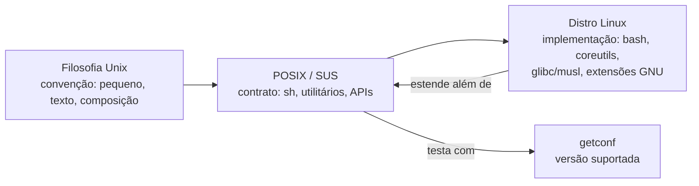

# Filosofia Unix e POSIX: princípios e portabilidade

## 1. O que é?

No tópico anterior o POSIX apareceu de passagem — "o kernel visa conformidade
POSIX" — sem explicar o que isso compra. Este tópico preenche a lacuna com duas
ideias que vivem em andares diferentes:

- **Filosofia Unix:** os hábitos de desenho nascidos nos Bell Labs dos anos 70 —
  programas pequenos que fazem uma coisa bem, conversam em texto e combinam-se em
  cadeia. Ninguém a "cumpre"; usa-se como bússola quando um desenho cheira mal.
- **POSIX:** o contrato escrito (IEEE Std 1003.1, também ISO/IEC 9945 e núcleo da
  Single UNIX Specification do Open Group): como um sistema "tipo Unix" deve
  comportar-se — chamadas de sistema, shell (`sh`), utilitários, APIs C. A edição
  vigente é a POSIX.1-2024 / SUSv5 (2024); muitos sistemas ainda declaram a anterior
  (ver Exemplos — incluindo o nosso).

Regra central deste tópico: **filosofia ≠ norma ≠ distro**. A filosofia orienta o desenho; o POSIX define o contrato portátil; cada distribuição Linux implementa um subconjunto — **nenhuma distro comum é integralmente POSIX por defeito sem qualificação**, e poucas são UNIX® certificadas (o Open Group regista que pelo menos uma distribuição Linux obteve certificação UNIX; a maioria não é certificada).

## 2. Por que existe?

- **Nos anos 70–80**, proliferaram variantes Unix incompatíveis ("look-alikes" divergentes, nas palavras do Open Group). Programas escritos para um Unix não corriam noutro.
- **O POSIX (anos 80 em diante)** respondeu com um contrato comum: se o script usa só o definido na norma, deve correr em qualquer sistema conforme — AIX, Solaris, macOS certificado, BSDs, ou Linux com userland compatível.
- **A filosofia** explica *por que* as ferramentas Linux têm o formato que têm (pequenas, texto, pipes); **o POSIX** explica *o que* pode assumir como portátil (sintaxe `sh`, flags de `ls`, `printf`, `test`, códigos de saída).

## 3. Como funciona?

Três camadas, do informal ao formal:



- A **filosofia** não é testável: é um guia ("faça uma coisa bem; escreva programas que trabalhem juntos; trate texto como interface universal").
- O **POSIX** é testável: `getconf _POSIX_VERSION` devolve a edição suportada; utilitários têm secções normativas (NAME, SYNOPSIS, OPTIONS, EXIT STATUS — ver Referências, volume XCU).
- A **distro** implementa o POSIX *mais* extensões (ex.: GNU coreutils adiciona flags além da norma; `bash` estende `sh`). Scripts que usam extensões deixam de ser portáteis — funcionam "no meu Linux", falham noutro `sh`.

Princípios históricos (Bell Labs; formulação clássica de McIlroy/Pike — convenção documentada, não cláusula normativa):

1. Faça **uma coisa bem feita**.
2. Programas devem **trabalhar juntos** (pipes, filtros).
3. **Texto** como interface universal (linhas, não formatos binários opacos).
4. **Composição** sobre monolitos: `origem | filtro | destino`.
5. Mecanismo, não política: defaults simples, configuráveis.

## 4. Onde fica no sistema?

| Elemento | Onde observar | Observação |
|----------|---------------|------------|
| Versão POSIX efetiva | `getconf _POSIX_VERSION` | `200809` = POSIX.1-2008/SUSv4; `202405` = POSIX.1-2024/SUSv5 (valor normativo `202405L` em `<unistd.h>`; o `getconf` imprime sem o sufixo `L`) |
| Shell padrão POSIX | `command -v sh` e `ls -l /bin/sh` | `/bin/sh` pode apontar para `bash`, `dash`, `ash` — comportamento varia (ver §12) |
| Utilitários normativos | `command -v printf test echo ls` | `command` é o localizador portátil (intrínseco POSIX); `which` é externo e não-normativo |
| Manuais | `man 1 printf`, `man 1p printf` (quando instalado, secção `1p` = POSIX) | Secção `1p` nem sempre instalada; ausência não significa não-conformidade |

## 5. Quando usar? / Quando NÃO usar?

- **Use o subconjunto POSIX** quando o script deve correr em várias distros, em `sh` desconhecido, em contentores mínimos (Alpine/BusyBox) ou em CI heterogéneo: `#!/bin/sh` + `printf` + `command -v` + `test` + `$(...)`.
- **NÃO assuma POSIX integral**: glibc vs. musl, `bash` vs. `dash`, GNU vs. BusyBox e flags estendidas quebram a portabilidade. Para interativo ou específico de uma distro, `#!/usr/bin/env bash` explícito é mais honesto que `#!/bin/sh` com bashismos.

## 6. Sintaxe

```bash
getconf _POSIX_VERSION        # edição POSIX efetiva (somente leitura)
command -v <nome>             # localizador portátil (intrínseco POSIX)
printf '%s\n' "texto"         # saída portátil (prefira a echo)
test -f ficheiro && echo ok   # ou [ -f ficheiro ]
```

Todos os comandos acima são **somente leitura** e seguros.

## 7. Exemplos

Exemplo 1 — versão POSIX efetiva:

```bash
getconf _POSIX_VERSION
```

Saída esperada (exemplo real, executado em 2026-10-15 — Omarchy, base Arch, x86_64):

```text
200809
```

Leitura: implementa o nível POSIX.1-2008/SUSv4. Valor documentado na norma como `200809L` para essa edição; o `getconf` local omite o sufixo `L`. **Facto documentado:** a edição vigente é a POSIX.1-2024/SUSv5 (ver Referências); este sistema reporta a edição anterior — prova prática de que "Linux" ≠ "POSIX mais recente em todo o lado".

Exemplo 2 — localizador portátil vs. não-portátil:

```bash
command -v ls
command -v printf
which ls
```

Saída esperada (mesmo ambiente, real):

```text
/usr/bin/ls
printf
/usr/bin/ls
```

Leitura: `command -v` é intrínseco POSIX e distingue embutidos (`printf` sem caminho = builtin) de externos (`/usr/bin/ls`); `which` é externo, não definido na norma — funciona aqui, mas **não assuma** noutros sistemas mínimos.

Exemplo 3 — comparativo `printf` (portátil) vs. `echo -e` (não-portátil):

```bash
printf '%s\n' 'olá' 'mundo'
echo -e 'a\tb'
printf 'a\tb\n'
```

Saída esperada (mesmo ambiente, real):

```text
olá
mundo
a	b
a	b
```

Leitura: `printf` tem formato explícito e previsível em qualquer `sh` POSIX; `echo -e` depende da implementação (alguns `echo` interpretam escapes, outros imprimem `-e` literalmente). Por isso scripts portáteis usam `printf`. **Aspeto não testado aqui:** comportamento do `echo` em `dash`/BusyBox — documentado como divergente na literatura POSIX, mas não executado neste ambiente (aqui `/bin/sh -> bash`).

Exemplo 4 — `test` e composição por texto:

```bash
test -d /etc && echo "dir-ok"
[ -f /etc/os-release ] && echo "file-ok"
echo "kernel: $(uname -s)"
```

Saída esperada (mesmo ambiente, real):

```text
dir-ok
file-ok
kernel: Linux
```

Leitura: `test`/`[` com códigos de saída + `$(...)` para substituição — ambos normativos — encadeados pela filosofia filtro/composição.

### Evidência de teste

Ambiente: Omarchy 4.0.4 (base Arch, kernel 7.2.5-3-omarchy, x86_64), 2026-10-15.
Todos os exemplos com output foram executados; nenhum output foi inventado.

| Comando / procedimento | Resultado esperado | Resultado observado | Estado |
|------------------------|--------------------|---------------------|--------|
| `getconf _POSIX_VERSION` | edição suportada | `200809` (= POSIX.1-2008/SUSv4) | executado |
| `command -v ls` / `command -v printf` / `which ls` | localizador portátil vs. externo | `/usr/bin/ls`, `printf` (builtin), `/usr/bin/ls` | executado |
| `printf '%s\n' 'olá' 'mundo'` | duas linhas | `olá` / `mundo` | executado |
| `echo -e 'a\tb'` vs `printf 'a\tb\n'` | ambos expandem aqui | `a\tb` → tab nos dois casos (neste `bash`) | executado |
| `test -d /etc`, `[ -f /etc/os-release ]`, `echo "kernel: $(uname -s)"` | `dir-ok`, `file-ok`, `kernel: Linux` | idêntico | executado |
| `man -w 1p printf` | variável | `No manual entry for printf in section 1p` | executado (limitação registada no §4) |
| `ls -l /bin/sh` | shell real | `/bin/sh -> bash` | executado |

Limitações: um único ambiente (`sh` = `bash`); comportamentos `dash`/`ash`-BusyBox/musl
marcados como documentados, não executados (§12); cross-distro prático pendente.

## 8. Erros comuns

| Erro | Causa | Correção |
|------|-------|----------|
| `#!/bin/sh` com `[[ ... ]]`, `function`, arrays | Bashismos num script declarado `sh` | Ou `#!/usr/bin/env bash` explícito, ou reescrever com `[ ]`, `case`, funções POSIX |
| `echo -e` imprime `-e` noutra distro | `echo` não-portátil | Usar `printf '%s\n'`, `printf 'a\tb\n'` |
| `which cmd` falha em contentor mínimo | `which` externo, ausente em BusyBox | Usar `command -v cmd` |
| "É Linux, logo é POSIX total" | Confundir userland GNU com certificação | Verificar com `getconf`, `man 1p`, matriz de certificação; programar para o subconjunto |
| `/bin/sh -> dash` vs `-> bash` quebra script | Assumir que `sh` = `bash` | Testar com o `sh` alvo ou escrever POSIX estrito |

## 9. Diagnóstico

Script falha numa distro mas não noutra? Pergunta-guia: **usei algo fora do contrato?**

```bash
ls -l /bin/sh                 # qual sh real? (bash? dash? ash?)
command -v comando-em-falta   # existe neste userland?
getconf _POSIX_VERSION        # que edição este sistema declara?
bash -n script.sh 2>&1 | head # sintaxe (se bash; para sh estrito, testar no sh alvo)
```

- Falha com `sh` mas passa com `bash` → bashismo provável (ex.: `[[`, `source`, `&>`).
- Falha só no Alpine/BusyBox → flag GNU ausente ou `which`/built-in divergente.
- `getconf` antigo + `man 1p` ausente → programar conservadoramente (só XCU base).

## 10. Segurança

Comandos deste tópico são somente leitura (`risk: baixo`). Nota de segurança indireta: scripts não-portáteis falham de formas surpreendentes em `sh` alheio (ex.: `test` mal citado); prefira `printf '%s\n' "$var"` citado e `test` explícito — evita word-splitting e interpretações divergentes.

## 11. Performance

Aqui a portabilidade é de borla: `printf` e `command -v` embutidos não custam mais
que `echo` ou `which`, e `$(...)` poupa os subshells que um pipe desnecessário
criaria. O ganho real não se mede em milissegundos mas em incidentes evitados —
cada "funciona na minha máquina" que desaparece vale mais que qualquer microtuning.
Se um dia o gargalo for mesmo velocidade de arranque de processos, o caminho é
`18-performance`, não trocar primitivas portáteis por atalhos frágeis.

## 12. Diferenças entre distribuições

O contrato POSIX é **universal na teoria**; a implementação **diverge na prática**. Tabela de pontos de divergência reais (não exaustiva):

| Família | `/bin/sh` típico | Evidência | Notas de portabilidade |
|---------|------------------|-----------|------------------------|
| Debian/Ubuntu | `dash` | documentada, não executada aqui | Scripts `sh` correm em `dash` estrito — bom teste de portabilidade |
| Arch (incl. base deste teste) | `bash` | **executada aqui** (`/bin/sh -> bash`) | Bashismos passam despercebidos — testar também em `dash` quando possível |
| Fedora/RHEL | `bash` | documentada, não executada aqui | Mesma cautela que Arch; SELinux não afeta POSIX de shell |
| openSUSE | `bash` | documentada, não executada aqui | Mesma cautela que Arch |
| Alpine | `ash` (BusyBox) | documentada, não executada aqui | Userland mínimo: `which` pode faltar; flags GNU ausentes — usar `command -v`, `printf`, `test` |
| Void | `dash` (a confirmar na fonte primária da distro) | não verificada aqui — a confirmar em `33-distributions` | Userland enxuto; sem systemd (não afeta shell) |
| NixOS | `bash` (via store) | documentada, não executada aqui | Caminhos `/bin` atípicos — `#!/usr/bin/env bash` obrigatório |

**Não testado neste ambiente:** `dash`, `ash`/BusyBox, musl — linhas acima marcadas como documentadas, não executadas. Detalhe de cada família em `33-distributions`.

## 13. Exercício

1. Execute `getconf _POSIX_VERSION` e diga que edição representa (`200809` = ?). Consulte as Referências para a edição vigente.
2. Execute `command -v sh bash printf test` e `ls -l /bin/sh`. O seu `sh` é qual shell real? Por que isso importa?
3. Reescreva `echo -e 'a\tb'` com `printf`. Execute ambos e explique a diferença de portabilidade.

## 14. Desafio

Sem instalar nada: um script com `#!/bin/sh`, `[[ -f x ]]` e `source lib.sh` passa no seu Arch/Omarchy mas falha no Debian (`dash`) e no Alpine. Identifique as 2 construções não-POSIX, reescreva-as (`[ -f x ]`, `. lib.sh`) e explique como `ls -l /bin/sh` em cada sistema teria antecipado o problema. (Resposta esperada: `[[ ]]` e `source` são bashismos; `.` (ponto) e `[ ]` são normativos.)

## 15. Referências oficiais

- Open Group — The UNIX® Standard / SUS como norma aberta; variantes Unix divergentes motivaram POSIX + SUS; certificação UNIX (inclui registo de distro Linux certificada) — https://www.opengroup.org/membership/forums/platform/unix
- POSIX.1-2024 / SUSv5 — Shell & Utilities (XCU), Introdução: comandos/utilitários de sistemas conformes; utilitários `sh`, `printf`, `test`, `command` — https://pubs.opengroup.org/onlinepubs/9799919799/utilities/V3_chap01.html
- Índice da norma vigente (Issue 8, IEEE Std 1003.1-2024) — https://pubs.opengroup.org/onlinepubs/9799919799/
- kernel.org — Linux como clone Unix visando POSIX/SUS (ponte com o tópico 1) — https://www.kernel.org/linux.html
