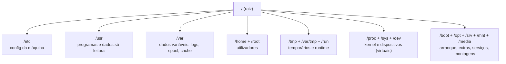
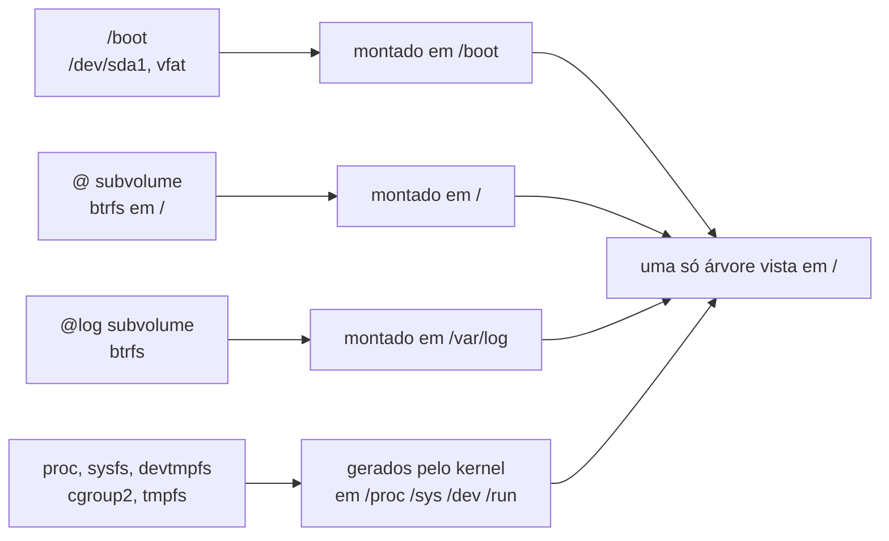

# Hierarquia do sistema de ficheiros e FHS essencial

## 1. O que é?

A **hierarquia do sistema de ficheiros** é a árvore única de diretórios que começa
na raiz `/` e contém tudo: configuração, programas, dados de utilizadores, dispositivos
e informação do kernel. Ao contrário do Windows (uma árvore por letra — `C:`, `D:`),
no Linux há **uma só árvore**; discos, partições e sistemas remotos são *encaixados*
(montados) em pontos dessa árvore (ex.: `/boot`, `/home`).

O **FHS** (*Filesystem Hierarchy Standard*, versão 3.0 de 2015, Linux Foundation) é a
norma que define onde cada coisa deve ficar: "requisitos e orientações para colocação
de ficheiros e diretórios em sistemas operativos tipo Unix", com o objetivo de que
software e utilizadores **prevejam a localização** de ficheiros (ver Referências —
resumo e capítulos 1–6 abertos na data de revisão).

## 2. Por que existe?

Sem convenção partilhada, cada distro colocaria `passwd`, os logs e os binários num
sítio diferente — e cada script, pacote e manual teria de adivinhar. O FHS existe para
que:

- fornecedores de software saibam onde instalar (ex.: configuração de máquina em `/etc`);
- criadores de distros construam sistemas previsíveis;
- utilizadores e scripts encontrem recursos sem conhecer a distro por dentro.

O próprio FHS declara o **âmbito limitado**: "a colocação local de ficheiros locais é
assunto local" — a norma coordena o que é partilhado entre distros, aplicações e
documentação, sem usurpar o administrador (cap. 1, ver Referências).

## 3. Como funciona?

Três ideias sustentam tudo:

1. **Uma árvore, muitos encaixes.** `/` é a raiz lógica; cada `mount` cola um sistema
   de ficheiros (partição, `tmpfs`, pseudo-FS) num diretório. O caminho `/var/log/syslog`
   pode viver fisicamente noutra partição ou subvolume sem o utilizador notar.
2. **Conteúdo por função, não por dono.** `/etc` = configuração da máquina; `/usr` =
   dados partilháveis só-leitura; `/var` = dados variáveis; `/home` = utilizadores.
3. **Pseudo-sistemas de ficheiros.** `/proc`, `/sys`, `/dev` (parte) e `/run` não são
   "ficheiros em disco": são janelas do kernel — ler `/proc/version` pergunta ao kernel
   em execução, não ao disco.





## 4. Onde fica no sistema?

Diretórios essenciais (finalidade segundo o FHS 3.0, caps. 3–5 e anexo Linux, cap. 6):

| Diretório | Tipo de conteúdo e finalidade |
|-----------|-------------------------------|
| `/` | Raiz da árvore; deve conter o suficiente para arrancar, recuperar e montar o resto |
| `/etc` | Configuração específica da máquina (editável pelo admin); nunca binários |
| `/usr` | Hierarquia principal: `/usr/bin` (comandos), `/usr/lib` (bibliotecas), `/usr/share` (dados independentes de arquitetura), `/usr/local` (compilações locais) |
| `/var` | Dados variáveis: `/var/log` (logs), `/var/lib` (estado), `/var/spool` (filas), `/var/cache`, `/var/tmp` (temporários que sobrevivem a reboot) |
| `/home` | Diretórios pessoais dos utilizadores (opcional na norma, universal na prática) |
| `/root` | Casa do root, separada de `/home` para estar disponível mesmo sem `/home` montado |
| `/tmp` | Temporários apagáveis a cada reboot (modo `1777`, ver Exemplos) |
| `/run` | Dados voláteis de runtime (PIDs, sockets; `tmpfs`, novidade do FHS 3.0; na norma antiga era `/var/run`) |
| `/dev` | Ficheiros de dispositivo (`/dev/null`, `/dev/zero`, `/dev/tty` obrigatórios no anexo Linux) |
| `/proc` | Informação de processos e do kernel (virtual; anexo Linux: método padrão *de facto*) |
| `/sys` | Informação de dispositivos/drivers (virtual; estrutura definida pelo kernel, "de resto não especificada") |
| `/boot` | Ficheiros estáticos do bootloader + kernel (ex.: `vmlinuz`); aqui é partição própria (ver Exemplos) |
| `/opt` | Pacotes de software adicionais (cada app na sua pasta) |
| `/mnt` | Ponto de montagem temporária pelo admin |
| `/media` | Ponto de montagem de media removível — **pode nem existir** (ausente neste ambiente, ver Exemplos) |
| `/srv` | Dados de serviços prestados pelo sistema (ex.: web/ftp) |

## 5. Quando usar? / Quando NÃO usar?

A hierarquia aprende-se de trás para a frente, a partir de perguntas concretas.
"Onde está a configuração disto?" — `/etc`, sempre. "Para onde foram os logs de
ontem?" — `/var/log`. "Que binário estou mesmo a correr?" — `/usr/bin` (ou o symlink
que lá aponta). Quando estas respostas saem sem pensar, o sistema deixou de ser um
labirinto.

O reverso também importa: caminhos absolutos copiados de tutoriais partem noutras
máquinas (`/media` pode nem existir; `/bin` pode ser symlink — ver §12). Em scripts,
verifique antes de assumir (`[ -d ... ]`, `command -v`) e trate `/etc`, `/boot` e
`/` como zonas de escrita deliberada: backup feito, reversão conhecida, só depois
a edição.

## 6. Sintaxe

```bash
ls /etc                    # listar (somente leitura)
stat -c '%a %n' /tmp       # tipo e permissões
readlink /bin              # para onde aponta um symlink
df -h / /boot              # ocupação por sistema montado
findmnt                    # árvore de montagens (somente leitura)
mount | head               # alternativa clássica (somente leitura)
find /etc -maxdepth 1      # pesquisa limitada, sem descer a árvore toda
```

Todos os comandos acima são **somente leitura** e seguros. `find` sem `-maxdepth`
na raiz pode demorar e atravessar pseudo-FS — limite sempre o alcance.

## 7. Exemplos

Exemplo 1 — que tipo de objeto é cada diretório:

```bash
stat -c '%n -> %F' / /etc /usr /var /home /root /tmp /run /dev /proc /sys /boot /opt /mnt /media
```

Saída esperada (exemplo real, executado em 2026-10-15 — Omarchy, base Arch, x86_64):

```text
/ -> directory
/etc -> directory
/usr -> directory
/var -> directory
/home -> directory
/root -> directory
/tmp -> directory
/run -> directory
/dev -> directory
/proc -> directory
/sys -> directory
/boot -> directory
/opt -> directory
/mnt -> directory
stat: cannot statx '/media': No such file or directory
```

Leitura: todos existem como diretórios **exceto `/media`** — prova de que nem todos os
diretórios do FHS existem em todas as instalações (`/media` é para media removível e
aqui não foi criado).

Exemplo 2 — symlinks do *usr-merge*:

```bash
for d in /bin /sbin /lib /lib64; do if [ -L $d ]; then echo "$d -> $(readlink $d)"; else echo "$d (diretório real)"; fi; done
```

Saída esperada (mesmo ambiente, real):

```text
/bin -> usr/bin
/sbin -> usr/bin
/lib -> usr/lib
/lib64 -> usr/lib
```

Leitura: `/bin`, `/sbin`, `/lib`, `/lib64` **não são diretórios reais** aqui — são links
para dentro de `/usr` (*merged-usr*, decisão da distro; o FHS 3.0 ainda documenta
`/bin` e `/sbin` como diretórios, pelo que isto é **implementação, não norma** — ver §12).

Exemplo 3 — onde vive cada parte (partições, pseudo-FS):

```bash
df -h / /boot
```

Saída esperada (mesmo ambiente, real, excerto):

```text
Filesystem        Size  Used Avail Use% Mounted on
/dev/mapper/root  464G   79G  384G  18% /
/dev/sda1         2.0G  199M  1.9G  10% /boot
```

```bash
findmnt /boot
```

Saída esperada (mesmo ambiente, real):

```text
TARGET SOURCE    FSTYPE OPTIONS
/boot  /dev/sda1 vfat   rw,relatime,fmask=0077,dmask=0077,codepage=437,iocharset=ascii,shortname=mixed,utf8,errors=remount-ro
```

Leitura: `/boot` é uma partição `vfat` pequena (2 GB, típica de boot EFI) — apagar ou
encher `/boot` impede arranques futuros. E no `findmnt` completo: `/` é btrfs
(subvolume `@`), `/var/log` é subvolume próprio (`@log`), `/tmp` e `/run` são `tmpfs`
(RAM), `/proc`/`/sys`/`/dev` são pseudo-FS (`proc`, `sysfs`, `devtmpfs`, `cgroup2`).

Exemplo 4 — kernel e permissões de temporários:

```bash
cat /proc/version
stat -c '%a %n' /tmp /var/tmp
```

Saída esperada (mesmo ambiente, real):

```text
Linux version 7.2.5-3-omarchy (linux-omarchy@omarchy) (gcc (GCC) 16.2.1 20260810, GNU ld (GNU Binutils) 2.47) #1 SMP PREEMPT_DYNAMIC Mon, 14 Sep 2026 19:55:01 +0000
1777 /tmp
1777 /var/tmp
```

Leitura: `/proc/version` confirma que `/proc` é janela do kernel (não ficheiro em disco);
`1777` = `rwxrwxrwt` — todos escrevem, mas o *sticky bit* (`1`) impede apagar ficheiros
alheios. Diferença `/tmp` (limpo no reboot) vs. `/var/tmp` (sobrevive ao reboot).

### Evidência de teste

Ambiente: Omarchy 4.0.4 (base Arch, kernel 7.2.5-3-omarchy, x86_64), 2026-10-15.
Todos os exemplos com output foram executados; nenhum output foi inventado.

| Comando / procedimento | Resultado esperado | Resultado observado | Estado |
|------------------------|--------------------|---------------------|--------|
| `stat` nos 15 diretórios | tipos de objeto | 14 diretórios; `/media` inexistente | executado |
| `readlink /bin /sbin /lib` (+`lib64`) | alvo dos symlinks | `usr/bin`, `usr/bin`, `usr/lib` (+`usr/lib`) | executado |
| `df -h / /boot` | ocupação | `/` 464G/18%, `/boot` 2.0G/10% | executado |
| `findmnt` (completo) | montagens | btrfs `@` em `/`, `@log` em `/var/log`, `tmpfs` em `/tmp` e `/run`, `proc/sysfs/devtmpfs/cgroup2` | executado |
| `findmnt /boot` | detalhe do boot | `/dev/sda1`, `vfat` | executado |
| `ls /etc`, `ls /run` | conteúdo típico | configs (`bash.bashrc`, `ca-certificates`…), runtime (`dbus`, `docker.sock`…) | executado |
| `cat /proc/version` | versão do kernel | `7.2.5-3-omarchy ... 14 Sep 2026` | executado |
| `ls /sys` | subsistemas do kernel | `block bus class dev devices firmware fs kernel module power …` | executado |
| `stat -c %a /tmp /var/tmp` | sticky bit | `1777` em ambos | executado |

Limitações: um único ambiente (btrfs + systemd + merged-usr); layouts ext4, `/media`
existente, `/usr` separado ou `/opt` populoso **não** foram observados — marcados como
documentados em §12.

## 8. Erros comuns

| Erro | Causa | Correção |
|------|-------|----------|
| Apagar "para libertar espaço" em `/boot` e o sistema não arranca | `/boot` pequeno e crítico; kernels/initramfs vivem lá | Gerir kernels com o gestor da distro; nunca `rm` manual em `/boot` |
| Editar às cegas em `/etc` sem backup e perder acesso (rede, sudo, boot) | `/etc` é configuração viva da máquina | Copiar antes (`cp f f.bak`), editar, saber desfazer; validar sintaxe quando houver validador |
| Assumir que `/media/pendrive` existe | `/media` pode nem existir (observado aqui) | Verificar com `ls`; em scripts, testar `[ -d ... ]` antes |
| Escrever em `/usr` à mão em vez de instalar pelo gestor | `/usr` é gerido por pacotes (só-leitura lógica) | Usar o gestor da distro; locais manuais: `/usr/local` ou `/opt` |
| `find /` sem limites e a máquina "pendura-se" em `/proc` | Pseudo-FS infinitos/recursivos | Sempre `-maxdepth`, `-xdev` ou alvo restrito (`/etc`) |
| Confundir `/tmp` com `/var/tmp` para dados entre reboots | `/tmp` é limpo no arranque | Persistência entre reboots: `/var/tmp` (ou `$HOME`) |

## 9. Diagnóstico

Disco "cheio" ou serviço que não escreve? Pergunta-guia: **qual montagem encheu?**

```bash
df -h                       # qual ponto está cheio? (somente leitura)
findmnt                     # é partição, subvolume ou tmpfs?
du -xhd1 /var 2>/dev/null | sort -h | tail  # onde está o volume (limitado a /var, sem atravessar mounts)
```

- `/` cheio mas `/var/log` é subvolume próprio → o problema pode estar noutro subvolume;
  ver cada montagem separada.
- `/boot` a 100% (vfat pequeno) → kernels acumulados; resolver pelo gestor de pacotes,
  nunca apagando às cegas.
- Erro só com media removível → verificar se `/media` existe e quem montou (`findmnt`).

## 10. Segurança

Comandos deste tópico são somente leitura (`risk: baixo`). A cautela é sobre
**alterações**, não sobre os comandos: `/etc` (configuração, ex.: `sudoers`, SSH),
`/boot` (arranque) e `/` (apagar recursivamente destrói o sistema) exigem backup,
ambiente descartável para treino e reversão conhecida antes de tocar. Nada neste
tópico apaga, move ou altera permissões.

## 11. Performance

Três factos com impacto prático: `/run` e `/tmp` em `tmpfs` vivem em RAM (rápidos,
mas consomem memória e não sobrevivem ao reboot); `/proc`/`/sys` têm custo de leitura
de kernel (evitar polling apertado em scripts); separar `/var/log` em subvolume/partição
(observado aqui) impede logs de encher `/`. Detalhe em `18-performance` e `11-storage`.

## 12. Diferenças entre distribuições

O FHS é **norma de colocação**; cada distro decide implementação. Pontos reais de
divergência (sem absolutos):

| Família | Ponto de divergência | Evidência |
|---------|----------------------|-----------|
| Arch (base deste teste) | *merged-usr*: `/bin`→`usr/bin` etc. | **executada aqui** (`readlink`) |
| Fedora/RHEL | *merged-usr* adotado há anos | documentada, não executada aqui |
| Debian/Ubuntu | *merged-usr* desde bookworm/23.10+; antes `/bin` real | documentada, não executada aqui |
| openSUSE | *merged-usr* (Tumbleweed/Leap recentes) | documentada, não executada aqui |
| Alpine | Base mínima: `/opt` e `/srv` frequentemente vazios/ausentes; BusyBox em `/bin` | documentada, não executada aqui |
| Void | Layout enxuto, sem `/srv` por omissão em instalações base | documentada, não executada aqui — a confirmar em `33-distributions` |
| NixOS | `/nix/store` fora do FHS (declarativo); resto emula FHS para compatibilidade | documentada, não executada aqui |

Outros: `/media` existe ou não conforme a distro/instalação (**ausente aqui**);
`/srv` vs. `/var/www` para conteúdo web varia; `/opt` populoso só onde há pacotes
de terceiros. Detalhe por família em `33-distributions`.

## 13. Exercício

1. Execute `stat -c '%n -> %F' / /etc /usr /var /tmp /proc /sys` e explique com as
   próprias palavras por que `/proc` e `/sys` aparecem como `directory` embora não
   sejam disco.
2. Execute `readlink /bin /sbin` e `findmnt /boot` (ou `df -h /boot`). O seu sistema
   usa *merged-usr*? `/boot` é partição própria?
3. Liste `ls /etc | head` e `ls /run | head`. Que diferença de natureza há entre os
   dois conteúdos?

### Mini-glossário

- **Ponto de montagem:** diretório onde um sistema de ficheiros é encaixado (`/boot`).
- **Symlink:** atalho ao nível do FS (`/bin -> usr/bin`); difere de montagem.
- **Pseudo-filesystem:** FS virtual servido pelo kernel (`proc`, `sysfs`, `tmpfs`, `cgroup2`).
- **Subvolume (btrfs):** subdivisão do volume com montagem e política próprias (`@`, `@log`).
- **Sticky bit (`1` em `1777`):** em diretório partilhado, só o dono apaga os próprios ficheiros.

## 14. Desafio

Sem instalar nada: o `df` mostra `/` com 40% livre mas uma app falha com "No space left
on device" ao escrever em `/var/log`. Explique dois cenários compatíveis com o layout
observado neste tópico (ex.: subvolume/partição de `/var/log` cheio isoladamente;
`tmpfs` de `/run` cheio se a app escreve lá; inodes esgotados) e que comandos
(`df -h`, `findmnt`, `du -xhd1`) distinguem cada hipótese. (Resposta esperada: quota
ou enchimento é por montagem, não por `/` global.)

## 15. Referências oficiais

- FHS 3.0 — índice e resumo (requisitos e orientações; 2015, Linux Foundation) — https://refspecs.linuxfoundation.org/FHS_3.0/fhs/index.html
- FHS 3.0, cap. 1 — Purpose e Scope (previsibilidade; colocação local é assunto local) — https://refspecs.linuxfoundation.org/FHS_3.0/fhs/ch01.html
- FHS 3.0, cap. 6 — anexo Linux (`/proc`, `/sys`, `/dev/null|zero|tty`, `/bin`, `/sbin`) — https://refspecs.linuxfoundation.org/FHS_3.0/fhs/ch06.html
- Ponte com o tópico 1 (`ls /`, userland em `/bin`–`/usr`) — [o-que-e-linux-kernel-vs-distribuicao.md](o-que-e-linux-kernel-vs-distribuicao.md)
