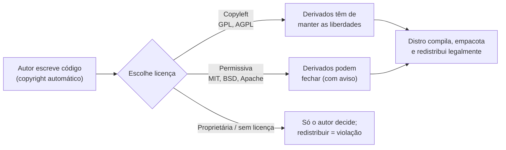

# Licenças e software livre: o essencial

> Nota: isto é literacia técnica, não aconselhamento jurídico. Para decisões reais
> (licenciar um produto, redistribuir), consulte a FSF, a OSI ou um advogado.

## 1. O que é?

Uma **licença de software** diz o que pode fazer com um programa: usar, copiar,
modificar, redistribuir — ou não. Como regra geral (Convenção de Berna; detalhes
variam por jurisdição), código sem licença é "todos os direitos reservados":
ninguém além do autor pode redistribuir nem modificar.

**Software livre** (*free software*, definição da FSF) é o que garante as 4 liberdades
essenciais: executar para qualquer propósito (0), estudar e modificar (1), redistribuir
cópias (2), distribuir versões modificadas (3). "Livre" é liberdade, não preço —
software livre **pode** ser comercial (ver Referências).

**Open source** (definição da OSI, 10 critérios) descreve quase o mesmo conjunto de
programas a partir de outros valores (metodologia e negócios em vez de liberdade do
utilizador). Na prática os conjuntos sobrepõem-se quase totalmente, mas os critérios
e a filosofia diferem — não use os termos como sinónimos exatos.

Duas famílias de licenças livres:

- **Copyleft** (ex.: GPL): quem redistribui (original ou modificado) não pode adicionar
  restrições — as liberdades propagam-se. É a regra que "protege as liberdades em vez
  de só as declarar".
- **Permissivas** (ex.: MIT, BSD, Apache-2.0): exigem pouco (aviso de copyright),
  permitem inclusive incorporar em programa proprietário.

## 2. Por que existe?

Porque uma distro é, juridicamente, uma **redistribuição de milhares de programas**.
Sem licenças livres claras, Debian, Fedora ou Arch não poderiam compilar, modificar e
entregar esse software. Consequências diretas:

- Distros separam o livre do resto (ex.: Debian `main` vs. `non-free-firmware`;
  Fedora evita proprietários; as distros endossadas pela FSF rejeitam "nonfree
  firmware blobs" e usam kernel limpo — ex.: Parabola GNU/Linux-libre, Trisquel;
  ver Referências, lista FSF — documentado, não testado aqui).
- O kernel Linux é **GPL-2.0-only** — "provided under the terms of the GNU General
  Public License version 2 only" com exceção explícita de syscall (documentação do
  kernel, ver Referências), confirmado localmente via pacote (ver Exemplos).
- O firmware ilustra o limite: neste ambiente há **730 ficheiros binários** em
  `/usr/lib/firmware` (contagem executada, ver Evidência) — binários redistribuíveis
  sob licenças variadas, nem todos livres — motivo pelo qual "ser Linux" não
  significa automaticamente "100% livre" em todas as distros.

## 3. Como funciona?



O mecanismo do copyleft: a licença **permite** tudo (usar, modificar, vender cópias)
sob **uma condição** — não retirar essas mesmas permissões de terceiros. As permissivas
trocam essa condição por atribuição mínima. Em ambos os casos, o texto da licença
acompanha o software instalado (ver §4 e Exemplos).

## 4. Onde fica no sistema?

| Pergunta | Onde ver | Observação |
|----------|----------|------------|
| Licença de um pacote instalado (Arch) | `pacman -Qi <pacote>` (campo `Licenses`) | Identificadores SPDX (`GPL-3.0-or-later`, `GPL-2.0-only`) |
| Textos de licença no disco | `/usr/share/licenses/<pacote>/` e `/usr/share/licenses/spdx/` (101 textos canónicos aqui) | Cada pacote traz o seu; `spdx/` tem os textos de referência |
| Licença de um pacote (Debian/Ubuntu) | `/usr/share/doc/<pacote>/copyright` | Formato próprio Debian (documentado, não executado aqui) |
| Licença no código-fonte | Cabeçalho `SPDX-License-Identifier:` | Convenção moderna, legível por ferramentas |

## 5. Quando usar? / Quando NÃO usar?

- **Use este conhecimento** para: escolher software sem surpresas (posso modificar?
  redistribuir? embutir no meu produto?), auditar dependências, perceber por que uma
  distro não traz certo driver/codec por omissão.
- **NÃO use** como atalho jurídico: "é open source no GitHub" ≠ "posso fazer tudo"
  (repositório sem `LICENSE` = como regra geral todos os direitos reservados); "GPL proíbe vender" é
  **falso** (a FSF afirma explicitamente que software livre pode ser comercial).

## 6. Sintaxe

```bash
ls /usr/share/licenses/ | head      # quantas licenças acompanham o sistema
pacman -Qi <pacote>                 # campo Licenses (Arch; somente leitura)
head -n 6 <ficheiro-de-licença>     # ler o início do texto (somente leitura)
```

Todos os comandos acima são **somente leitura** e seguros. (Debian/Ubuntu/Fedora:
ver tabela §12 para os equivalentes.)

## 7. Exemplos

Exemplo 1 — quantos textos de licença o sistema traz:

```bash
ls /usr/share/licenses/ | wc -l
ls /usr/share/licenses/spdx/ | wc -l
```

Saída esperada (exemplo real, executado em 2026-10-15 — Omarchy, base Arch, x86_64):

```text
593
101
```

Leitura: 593 pastas de licenças de pacotes + 101 textos canónicos SPDX. Licença não é
abstração — está instalada no disco.

Exemplo 2 — licença de programas concretos:

```bash
pacman -Qi bash | grep -i Licenses
pacman -Qi linux-omarchy | grep -i Licenses
```

Saída esperada (mesmo ambiente, real):

```text
Licenses        : GPL-3.0-or-later
Licenses        : GPL-2.0-only
```

Leitura: o shell `bash` é GPL-3.0 ("ou posterior"); o kernel é **GPL-2.0-only**
(só v2, sem "ou posterior") — detalhe com consequências reais para redistribuição.

Exemplo 3 — ler o início de textos reais:

```bash
head -n 5 /usr/share/licenses/spdx/GPL-3.0-only.txt
head -n 6 /usr/share/licenses/ncurses/COPYING
```

Saída esperada (mesmo ambiente, real):

```text
GNU GENERAL PUBLIC LICENSE
Version 3, 29 June 2007

Copyright © 2007 Free Software Foundation, Inc. <https://fsf.org/>
```

```text
Copyright 2018-2024,2025 Thomas E. Dickey
Copyright 1998-2017,2018 Free Software Foundation, Inc.

Permission is hereby granted, free of charge, to any person obtaining a
copy of this software and associated documentation files (the
"Software"), to deal in the Software without restriction, including
```

Leitura: o primeiro é copyleft (GPLv3); o segundo é permissivo estilo MIT (ncurses) —
"sem restrição, incluindo…" mediante aviso. Dois regimes, um comando de distância.

### Evidência de teste

Ambiente: Omarchy 4.0.4 (base Arch, kernel 7.2.5-3-omarchy, x86_64), 2026-10-15.
Todos os exemplos com output foram executados; nenhum output foi inventado.

| Comando / procedimento | Resultado esperado | Resultado observado | Estado |
|------------------------|--------------------|---------------------|--------|
| `ls /usr/share/licenses/ \| wc -l` | contagem de pastas | `593` | executado |
| `ls /usr/share/licenses/spdx/ \| wc -l` | textos canónicos | `101` (incl. `GPL-3.0-only.txt`) | executado |
| `pacman -Qi bash` (Licenses) | identificador SPDX | `GPL-3.0-or-later` | executado |
| `pacman -Qi linux-omarchy` (Licenses) | identificador SPDX | `GPL-2.0-only` | executado |
| `head` nos dois textos | inícios dos textos | idênticos aos transcritos | executado |
| `ls /usr/lib/firmware/ \| wc -l` | binários de firmware presentes | `730` ficheiros (`.bin.zst` e afins) | executado |
| Equivalentes Debian (`/usr/share/doc/*/copyright`), Fedora, NixOS | — | — | **não executados**; §12 marcado como documentado |

Limitações: um único ambiente; nada foi instalado, modificado ou redistribuído —
nenhuma implicação jurídica foi testada (nem poderia ser por comandos).

## 8. Erros comuns

| Erro | Causa | Correção |
|------|-------|----------|
| "Está no GitHub, é open source, posso usar como quiser" | Repositório sem ficheiro de licença | Como regra geral, sem licença = todos os direitos reservados; procure `LICENSE`/`COPYING` e o identificador SPDX |
| "GPL proíbe uso comercial" | Confundir livre com grátis | Falso: a definição FSF exige permitir uso/desenvolvimento/distribuição comercial |
| "Tudo no Linux é GPL" | Generalizar a licença do kernel | Kernel = GPL-2.0-only; userland mistura MIT/BSD/Apache/GPL (ex.: ncurses permissivo acima) |
| Remover avisos de copyright ao copiar | Achar que aviso é opcional | Quase todas as licenças (inclusive permissivas) exigem preservar o aviso |
| Chamar qualquer "código visível" de open source | Ignorar os 10 critérios OSI | *Source available* ≠ open source (ex.: restrição de campo de uso viola o critério 6) |

## 9. Diagnóstico

"Deste programa, o que posso fazer?" — pergunta-guia em 3 passos, todos somente leitura:

```bash
pacman -Qi <pacote> | grep -i Licenses   # Arch: identificador SPDX
ls /usr/share/licenses/<pacote>/         # Arch: texto instalado
head -n 10 <texto>                        # ler condições na fonte
```

- Sem texto e sem identificador → tratar como não-livre até prova em contrário.
- `GPL-*-only` vs `GPL-*-or-later` → versões diferentes, obrigações diferentes ao redistribuir.
- Firmware/driver que a distro não traz por omissão → suspeita de blob proprietário;
  confirmar na documentação da distro antes de instalar de terceiros.

## 10. Segurança

Comandos deste tópico são somente leitura (`risk: baixo`). A cautela é de
**procedência**, não de sintaxe: software sem licença clara ou de origem duvidosa não
deve entrar num sistema sério — prefira repositórios oficiais da distro, verifique
assinaturas quando existirem e registe de onde veio cada artefacto externo. Detalhe em
`13-seguranca`.

## 11. Performance

Licenças não correm — não há impacto em runtime para medir. O impacto é todo a
montante, e é onde dói: descobrir a meio do projeto que uma dependência não pode ser
redistribuída custa semanas; escolher entre GPL e permissiva no primeiro dia custa
uma conversa. Por isso a regra seca de encerrar a secção: decida a licença cedo,
por escrito, uma vez — e audite dependências novas com o mesmo gesto automático com
que corre os testes.

## 12. Diferenças entre distribuições

O conceito (copyright + licenças) é **universal**; a *política* de cada distro difere:

| Família | Política de software não-livre | Evidência |
|---------|-------------------------------|-----------|
| Arch (base deste teste) | Pragmática: `extra` traz blobs/firmware; licenças em `/usr/share/licenses/` | **executada aqui** |
| Debian/Ubuntu | `main` 100% livre (DFSG); firmware em `non-free-firmware` separado | documentada, não executada aqui |
| Fedora/RHEL | Sem proprietários nos repos oficiais (RPM Fusion à parte) | documentada, não executada aqui |
| openSUSE | Oss vs. non-oss separados | documentada, não executada aqui |
| Alpine | `main` vs. `community`/`testing`; base mínima | documentada, não executada aqui |
| NixOS | Opção declarativa `allowUnfree` (recusa por omissão) | documentada, não executada aqui |
| FSF-endossadas (Trisquel, Parabola) | 100% livres, kernel linux-libre | documentada, não executada aqui |

Detalhe por família em `33-distributions`.

## 13. Exercício

1. Execute `pacman -Qi bash linux-omarchy 2>/dev/null | grep -i Licenses` (ou o
   equivalente da sua distro) e explique cada identificador com as próprias palavras.
2. Execute `head -n 6` num texto copyleft (`spdx/GPL-3.0-only.txt`) e num permissivo
   (ex.: licença do `ncurses`) e aponte a diferença de tom/obrigação.
3. Encontre um programa **sem** identificador claro e descreva o procedimento seguro
   (não o instale/redistribua até esclarecer).

### Mini-glossário

- **Copyright:** direito exclusivo de cópia do autor, automático ao criar (regra geral, Convenção de Berna).
- **Copyleft:** licença que obriga derivados a manter as liberdades (GPL).
- **Permissiva:** licença que só exige atribuição (MIT, BSD, Apache-2.0).
- **SPDX:** identificadores curtos padrão de licenças (`GPL-2.0-only`).
- **Blob (firmware):** binário proprietário carregado em hardware; motivo clássico de
  distros o separarem.
- **Tivoização:** hardware que recusa executar versões modificadas (a FSF considera
  que esvazia a liberdade 1).

## 14. Desafio

Sem instalar nada: uma empresa quer embutir num produto fechado (a) uma biblioteca
MIT e (b) uma biblioteca GPL-3.0-only, sem publicar o código do produto. Explique por
que (a) é permitido pela licença e (b) viola a GPL — e que alternativas existem
(reimplementar, usar alternativa permissiva/LGPL conforme o caso, ou publicar o código
sob GPL). (Resposta esperada: MIT exige só aviso; GPL exige derivados sob GPL.)

## 15. Referências oficiais

- FSF — "What is Free Software?" (4 liberdades; livre pode ser comercial; copyleft) — https://www.gnu.org/philosophy/free-sw.html
- FSF — "What is Copyleft?" (quem redistribui, com ou sem alterações, tem de repassar a liberdade) — https://www.gnu.org/licenses/copyleft.html
- OSI — "The Open Source Definition" (10 critérios; derivada das DFSG Debian) — https://opensource.org/osd
- OSI — texto da licença MIT (permissões incluindo sublicenciar/vender; condição: preservar aviso) — https://opensource.org/licenses/mit-license
- FSF — distros GNU/Linux livres (rejeitam blobs de firmware não-livres; ex.: Parabola, Trisquel) — https://www.gnu.org/distros/free-distros.html
- Kernel — "Linux kernel licensing rules" (kernel sob GPL-2.0 only + exceção de syscall; SPDX) — https://www.kernel.org/doc/html/latest/process/license-rules.html
- GNU — "Linux and the GNU System" (ponte: sistema GNU + kernel Linux) — https://www.gnu.org/gnu/linux-and-gnu.html
