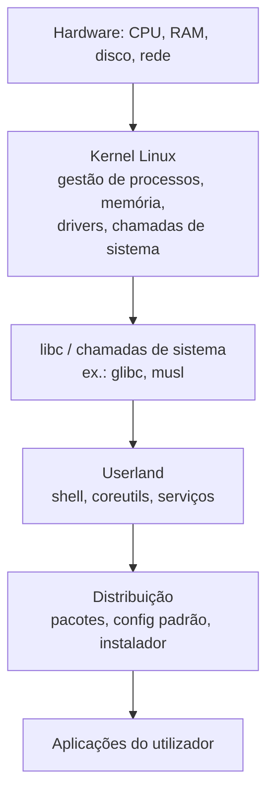

# O que é Linux: kernel vs. distribuição

## 1. O que é?

**Linux é o kernel**: o programa que gere CPU, memória, processos, acesso a hardware e comunicação entre software e dispositivos.

O que o utilizador chama "Linux" no dia a dia (Ubuntu, Fedora, Arch, Debian) é na verdade uma **distribuição**: kernel Linux + ferramentas GNU e outro userland + sistema de pacotes + instalador + configuração padrão.

Esta distinção não é convenção deste manual: o próprio kernel.org define Linux como
"clone do Unix escrito do zero por Linus Torvalds, visando conformidade POSIX" — e
diz explicitamente a quem chega agora para **descarregar uma distribuição, não o
kernel**. O projeto GNU diz o mesmo por outras palavras: "Linux é o kernel…
normalmente usado em combinação com o sistema operativo GNU". Duas fontes
independentes, mesma fronteira (ver Referências).

## 2. Por que existe?

- **Kernel separado do sistema:** permite o mesmo núcleo servir servidores, desktops, routers, telemóveis e contentores, mudando apenas o userland e as ferramentas.
- **Distribuições:** empacotam kernel + milhares de programas + instalação/arranque funcionais "out of the box", problema que o kernel sozinho não resolve (instalação, boot, configuração, atualizações).
- **Sem esta separação**, cada utilizador teria de compilar o kernel, montar libc, shell, utilitários e bootloader à mão.

## 3. Como funciona?

Camadas, de baixo para cima:



Quando executa `ls`, o fluxo é: shell → `execve()` (chamada de sistema) → kernel localiza o binário, gere permissões, aloca memória, devolve o resultado. O comando `ls` não é o kernel; é um programa do userland que **pede serviços ao kernel**.

## 4. Onde fica no sistema?

| Componente | Local típico | Observação |
|------------|--------------|------------|
| Kernel em execução | reportado por `uname -r` | Ficheiro de boot varia por distro (ex.: `/boot/vmlinuz-*`); neste ambiente `/boot` não é listável sem privilégio (`Permission denied` observado) — usar `uname -r` |
| Distribuição | `/etc/os-release` | Ficheiros `ID`, `ID_LIKE`, `VERSION_ID` identificam família |
| Userland base | `/bin`, `/usr/bin`, `/lib*` | `ls /` mostra a hierarquia (detalhe em `04-filesystem`) |
| Info do sistema | `hostnamectl` | Nome, kernel, arquitectura |

## 5. Quando usar? / Quando NÃO usar?

Use a distinção como ferramenta de diagnóstico: perante um problema, a primeira
pergunta é "morreu o kernel/driver ou a distro/pacote/config?" — a resposta decide
se lê `dmesg` ou `journalctl`, se reporta à distro ou ao upstream, e que versão
anota no bug (a do kernel ≠ a da distro). Ao escolher distro, compare userland e
política de atualização, não "qual tem melhor kernel" — o núcleo é o mesmo projeto.

Em documentação técnica, nunca escreva só "Linux": escreva "kernel 6.x" quando for
do núcleo e "Ubuntu 24.04" ou "Arch rolling" quando for do sistema. A ambiguidade
aqui custa horas de diagnóstico errado.

## 6. Sintaxe

```bash
uname -srmo          # kernel: nome, versão, arquitectura, sistema operativo
cat /etc/os-release  # distribuição: ID, versão, família
hostnamectl          # nome, kernel, arquitectura (somente leitura)
ls /                 # hierarquia raiz (somente leitura)
```

Todos os comandos acima são **somente leitura** e seguros.

## 7. Exemplos

```bash
uname -srmo
```

Saída esperada (exemplo real, executado em 2026-10-15 — Omarchy, base Arch, x86_64):

```text
Linux 7.2.5-3-omarchy x86_64 GNU/Linux
```

Leitura: nome `Linux`, versão `7.2.5-3-omarchy`, arquitectura `x86_64`, sistema `GNU/Linux`.

```bash
cat /etc/os-release
```

Saída esperada (mesmo ambiente, excerto real):

```text
NAME="Omarchy"
PRETTY_NAME="Omarchy"
ID=omarchy
ID_LIKE=arch
BUILD_ID="4.0.4"
VERSION_ID="4.0.4"
```

Leitura: `ID_LIKE=arch` indica família Arch → gestor esperado `pacman` (detalhe em `08-pacotes`, matriz em `33-distributions`).

```bash
ls /
```

Saída esperada (mesmo ambiente):

```text
bin  boot  dev  etc  home  lib  lib64  mnt  opt  proc
root  run  sbin  srv  swap  sys  tmp  usr  var
```

Isto é o userland/hierarquia provido pela distribuição, não o kernel em si.

### Evidência de teste

Ambiente: Omarchy 4.0.4 (base Arch, kernel 7.2.5-3-omarchy, x86_64), 2026-10-15.
Todos os exemplos com output foram executados; nenhum output foi inventado.

| Comando / procedimento | Resultado esperado | Resultado observado | Estado |
|------------------------|--------------------|---------------------|--------|
| `uname -srmo` | nome, versão, arquitetura, sistema | `Linux 7.2.5-3-omarchy x86_64 GNU/Linux` | executado |
| `cat /etc/os-release` | ID da distro | `ID=omarchy`, `ID_LIKE=arch` | executado |
| `ls /` | hierarquia raiz | 19 entradas (`bin boot dev etc home lib lib64 mnt opt proc root run sbin srv swap sys tmp usr var`) | executado |
| `ls /boot` (tentativa sem privilégio) | variável | `Permission denied` | executado (limitação registada no §4) |

Limitações: um único ambiente (sem Debian/Fedora/Alpine para cross-distro prático);
divergências por família marcadas como documentadas em `33-distributions`.

## 8. Erros comuns

| Erro | Causa | Correção |
|------|-------|----------|
| "Vou descarregar o kernel para instalar Linux" | Confundir kernel com sistema completo | Descarregar uma **distribuição** (ISO), não o tarball de kernel.org |
| `uname -a` mostra uma distro, `cat /etc/os-release` mostra outra (em contentor) | Contentor partilha o kernel do host, mas tem userland próprio | Normal: kernel = host, distro = imagem do contentor |
| "Comando X não existe na minha distro" | Assumir que toda distro traz o mesmo userland | Verificar gestor de pacotes da família (`08-pacotes`) em vez de copiar comandos de outra família |
| `ls: cannot open directory '/boot': Permission denied` | Diretório com permissão restrita | Esperado sem privilégio; usar `uname -r` para versão do kernel em vez de inspecionar `/boot` |

## 9. Diagnóstico

Pergunta-guia: **o sintoma segue o kernel ou segue a distro?**

```bash
uname -r              # qual kernel está a correr?
cat /etc/os-release   # qual distro/userland?
```

- Mesmo sintoma em distros diferentes com o **mesmo kernel** → suspeita de kernel/driver.
- Sintoma só numa distro / após atualização de pacotes → suspeita de empacotamento/configuração da distro.
- Em contentores: confirmar kernel do host vs. `/etc/os-release` do contentor antes de concluir.

## 10. Segurança

Comandos deste tópico são somente leitura (`risk: baixo`). Nenhum altera o sistema. Nota: `hostnamectl set-hostname` (escrita) **não** é abordado aqui.

## 11. Performance

Saber onde vive cada camada evita otimizar no sítio errado — o erro clássico de
iniciante (e de pressa): reinstalar distros à procura de velocidade quando o gargalo
é um driver, um disco lento ou um parâmetro do kernel. Regra prática: se o problema
é igual em live USBs de distros diferentes, o culpado está abaixo da distro
(kernel, driver, hardware) e troca de distro nenhuma resolve; se só aparece depois
de atualizar pacotes, está acima. Os parâmetros que realmente mexem (`sysctl`,
agendador de I/O) vivem em `14-kernel` e `18-performance`.

## 12. Diferenças entre distribuições

O conceito é **universal**: toda a família usa o mesmo kernel Linux (com patches/configurações próprias) + userland e ferramentas diferentes. Não há comando divergente neste tópico; a divergência aparece nos próximos módulos:

| Família | O que muda (próximos módulos) | Detalhe em |
|---------|-------------------------------|------------|
| Debian/Ubuntu | `apt`, `sudo` por padrão, `netplan` (Server) | `08-pacotes`, `33-distributions` |
| Arch | `pacman`, rolling release | `08-pacotes`, `33-distributions` |
| Fedora/RHEL | `dnf`, SELinux enforcing | `08-pacotes`, `13-seguranca` |
| openSUSE | `zypper`, YaST | `08-pacotes`, `33-distributions` |
| Alpine | `apk`, musl + BusyBox, OpenRC | `08-pacotes`, `09-systemd` |
| Void | `xbps-install`, runit (sem systemd) | `08-pacotes`, `09-systemd` |
| NixOS | `nix`, configuração declarativa | `08-pacotes`, `33-distributions` |

## 13. Exercício

1. Execute `uname -srmo` e transcreva cada campo com as próprias palavras (nome? versão? arquitectura?).
2. Execute `cat /etc/os-release` e identifique `ID` e `ID_LIKE` da sua distro. Qual família da tabela acima?
3. Execute `ls /` e aponte 3 diretórios que pertencem ao userland/distribuição, não ao kernel.

## 14. Desafio

Sem instalar nada: explique por que um contentor Alpine a correr num host Ubuntu reporta o **kernel do Ubuntu** em `uname -r` mas `ID=alpine` em `/etc/os-release`. (Resposta esperada: kernel partilhado com o host; userland isolado por namespaces. Detalhe em `23-containers`.)

## 15. Referências oficiais

- kernel.org — "About Linux Kernel": Linux como clone Unix visando POSIX; "não descarregue o kernel, descarregue uma distribuição" — https://www.kernel.org/linux.html
- kernel.org — Sobre a organização / distribuição do kernel — https://www.kernel.org/category/about.html
- GNU — "Linux and the GNU System" (Stallman): "Linux is the kernel... normally used in combination with the GNU operating system" — https://www.gnu.org/gnu/linux-and-gnu.html
- Documentação do kernel (referência técnica): https://docs.kernel.org/
