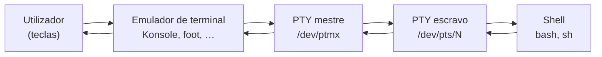

# O terminal, o PTY e o shell

## 1. O que é?

Três peças que todos confundem:

- **Terminal**: o dispositivo (físico ou emulado) que mostra texto e recebe teclas.
  Hoje quase sempre um **emulador**: Konsole, GNOME Terminal, Alacritty, foot, o
  embutido no VS Code — ou um multiplexador como `tmux`.
- **Shell** (`bash`, `sh`, `zsh`…): o programa que interpreta o que escreve
  (`ls`, pipes, scripts). Corre *dentro* do terminal; não é o terminal.
- **PTY** (pseudo-terminal): o par mestre/escravo (`/dev/ptmx` + `/dev/pts/N`) que
  liga os dois — o kernel finge que o emulador é um terminal de hardware, e o shell
  acredita.

Fontes primárias: `man 7 pty` (interface do kernel), `man 1 tty`/`man 1 tmux`,
norma POSIX (`stty`, XCU) — ver Referências.

## 2. Por que existe?

Terminais físicos (teletipos, VT100) falavam por linha série; o Unix abstraiu-os
como ficheiros (`/dev/tty*`). Quando o hardware desapareceu, o **PTY** manteve o
contrato: qualquer programa escrito para "um terminal" (shell, `ssh`, `vim`,
`tmux`) continua a funcionar sobre uma janela gráfica ou uma sessão remota, sem
mudança. Sem PTY, cada emulador precisaria de um protocolo próprio com cada shell.

## 3. Como funciona?



O emulador escreve bytes no mestre; o kernel entrega-os ao escravo como *input* do
shell; a saída faz o caminho inverso. Variáveis de ambiente contam a história:
`TERM` diz ao sistema **que dialeto** o terminal fala (cores, teclas — base
`terminfo`); `SHELL` diz qual o shell de login. `tput`/`infocmp` leem essa base;
`stty` configura a disciplina de linha — mas só funciona com um terminal real
(ver §8: neste ambiente sem TTY, `stty` falha honestamente).

## 4. Onde fica no sistema?

| Elemento | Onde observar | Observação |
|----------|---------------|------------|
| PTY mestre | `/dev/ptmx` (aqui: `crw-rw-rw- root tty 5, 2`) | Multiplexador de PTYs do kernel |
| PTY escravos | `/dev/pts/0`, `/dev/pts/1`… (aqui: `0`, `1`) | Um por sessão de terminal |
| Meu terminal? | `tty` | Responde o escravo — ou `not a tty` sem terminal (ver Exemplos) |
| Meu shell? | `echo $SHELL` + `ps -o pid,comm,tty -p $$` | Aqui: `/usr/bin/bash`, sem TTY de controlo (`?`) |
| Dialeto | `echo $TERM` + `infocmp` | Aqui: `xterm-256color`, 256 cores (`tput colors`) |
| Multiplexador | `command -v tmux screen` | Aqui: `tmux` 3.7c instalado; `screen` ausente |

## 5. Quando usar? / Quando NÃO usar?

O terminal é a casa do trabalho interativo; o `tmux` é o seguro dessa casa. Sempre
que uma sessão valha mais do que a janela que a contém — SSH instável, compilação
longa, monitorização durante a noite — abra-a destacada primeiro e poupe-se ao
funeral do processo morto com a janela.

O reverso engana: `stty`, `reset` e `tput` fora de um TTY não "falham" — respondem
honestamente que não há terminal para configurar (`Inappropriate ioctl`). Trate esse
erro como diagnóstico gratuito, não como avaria (ver troubleshooting do eixo).

## 6. Sintaxe

```bash
tty                              # que terminal sou? (somente leitura)
echo "TERM=$TERM SHELL=$SHELL"   # dialeto + shell (somente leitura)
ps -o pid,comm,tty -p $$         # o meu shell e o seu TTY (somente leitura)
ls /dev/pts/                     # escravos existentes (somente leitura)
tput colors; infocmp | head      # capacidades do dialeto (somente leitura)
tmux new-session -d -s nome      # sessão destacada (reversível: kill-session)
```

Todos somente leitura exceto `tmux`, que cria estado próprio e descartável.

## 7. Exemplos

Exemplo 1 — quem sou nesta sessão:

```bash
echo "TERM=$TERM SHELL=$SHELL"
tty
ps -o pid,comm,tty -p $$
```

Saída esperada (exemplo real, executado em 2026-10-15 — Omarchy/Arch x86_64):

```text
TERM=xterm-256color SHELL=/usr/bin/bash
not a tty
    PID COMMAND         TT
 329603 bash            ?
```

Leitura: dialeto `xterm-256color`, shell `bash` — mas **sem terminal de controlo**:
`tty` diz `not a tty` e o `TT` é `?`. Este próprio ambiente de execução é um processo
sem TTY (típico de agentes/CI/pipes). Conclusão pedagógica central: *ter shell não
implica ter terminal*.

Exemplo 2 — PTYs do sistema:

```bash
ls /dev/pts/
ls -l /dev/ptmx
```

Saída esperada (mesmo ambiente, real):

```text
0
1
ptmx
crw-rw-rw- 1 root tty 5, 2 Oct 15 15:16 /dev/ptmx
```

Leitura: dois escravos ativos (outras sessões gráficas/SSH) + mestre `ptmx`
(dispositivo de caracteres 5:2). Cada janela de terminal que abrir cria um novo
número aqui.

Exemplo 3 — multiplexador real (ciclo completo e reversível):

```bash
tmux new-session -d -s audittest -x 200 -y 50
tmux ls
tmux kill-session -t audittest
tmux ls
```

Saída esperada (mesmo ambiente, real — `tmux 3.7c`):

```text
audittest: 1 windows (created Thu Oct 15 15:16:06 2026)
no server running on /tmp/tmux-1000/default
```

Leitura: sessão criada (1 janela), listada, **destruída**, e o servidor terminou
sozinho (`no server running`). `tmux` dá PTYs persistentes: a sessão sobrevive ao
fecho da janela — aqui provámos criar e limpar.

Exemplo 4 — capacidades do dialeto:

```bash
tput colors
infocmp | head -n 3
```

Saída esperada (mesmo ambiente, real):

```text
256
#	Reconstructed via infocmp from file: /usr/share/terminfo/./x/xterm-256color
xterm-256color|xterm with 256 colors,
	am, bce, ccc, km, mc5i, mir, msgr, npc, xenl,
```

Leitura: 256 cores; a base `terminfo` descreve o dialeto em capacidades (`am`,
`bce`…). Programas como `vim`/`less -R` consultam isto — `TERM` errado = artefactos
(ver troubleshooting).

### Evidência de teste

Ambiente: Omarchy 4.0.4 (base Arch, kernel 7.2.5-3-omarchy, x86_64), 2026-10-15.
Todos os exemplos com output foram executados; nenhum output foi inventado.

| Comando / procedimento | Resultado esperado | Resultado observado | Estado |
|------------------------|--------------------|---------------------|--------|
| `echo TERM/SHELL`, `tty`, `ps -p $$` | dialeto, shell, TTY | `xterm-256color`, `/usr/bin/bash`, `not a tty` / `?` | executado |
| `ls /dev/pts/`, `ls -l /dev/ptmx` | escravos + mestre | `0 1 ptmx`; `crw-… 5, 2` | executado |
| ciclo `tmux` criar→listar→matar | sessão descartável | criada, listada, morta; servidor terminou | executado |
| `tput colors`, `infocmp` | capacidades | `256`; `xterm-256color` | executado |
| `stty -a` sem TTY | erro honesto | `Inappropriate ioctl for device` | executado |
| `screen` instalado? | — | ausente (`command -v` só achou `tmux`); pacote `screen 5.0.2-2` existe nos repos | executado |

Limitações: sem terminal físico/SSH real para comparar; emuladores gráficos
(Konsole, foot) e outras distros documentados em §12, não executados.

## 8. Erros comuns

| Erro | Causa | Correção |
|------|-------|----------|
| `stty: Inappropriate ioctl for device` | stdin não é terminal (pipe, CI, agente) | Esperado; redirecione de um TTY ou aceite modo não-interativo |
| `tty` diz `not a tty` e "nada funciona" | Confundir shell com terminal | Há shell sem terminal; programas interativos precisam de PTY real |
| Cores/artefactos no `vim` remoto | `TERM` errado ou `terminfo` ausente no remoto | Alinhar `TERM` (`export TERM=xterm-256color`) ou instalar terminfo |
| Sessão morre ao fechar a janela/SSH | Processo preso ao PTY da sessão | Usar `tmux`/`nohup` (ver referência) |
| "Abri 50 terminais e está lento" | Cada PTY + shell + emulador consome RAM/GPU | `tmux` com janelas em vez de N emuladores |

## 9. Diagnóstico

Sem terminal ou com artefactos? Pergunta-guia: **há PTY entre mim e o shell?**

```bash
tty; ps -o pid,comm,tty -p $$   # tenho terminal de controlo?
echo "TERM=$TERM"; tput colors  # dialeto válido e com cores?
ls /dev/pts/                    # há escravos? (sessões de quem?)
tmux ls 2>&1                    # há multiplexador a correr?
```

- `not a tty` + `TT=?` → sem terminal; nada de `stty`/`reset` aqui.
- Cores erradas só no remoto → `TERM` herdado não existe no remoto.
- Tudo "preso" → sessão agarrada ao PTY; reanexar via `tmux attach` (ver referência).

## 10. Segurança

Comandos deste tópico são somente leitura, exceto `tmux` (`risk: baixo`): sessões
`tmux` destacadas **permanecem com os seus processos** — não deixe sessão root
aberta e destacada; `tmux kill-server` no fim em máquinas partilhadas. `/dev/pts/*`
de outros utilizadores não se espiam (`mesg`, permissões) — respeite privacidade.

## 11. Performance

PTY é barato (bytes em memória); o custo está no emulador (render GPU) e nos shells
abertos. `tmux` com dezenas de janelas ociosas ≈ dezenas de shells parados —
desprezível em CPU, visível em RAM só em escala. Nada aqui exige tuning (detalhe em
`18-performance` se um dia precisar).

## 12. Diferenças entre distribuições

O mecanismo PTY/terminfo é **universal** (kernel + ncurses em todo o lado). O que muda:

| Família | Emulador omisso típico / notas | Evidência |
|---------|-------------------------------|-----------|
| Arch (base deste teste) | Sem omissão definida; `tmux` 3.7c instalado aqui; `screen` 5.0.2-2 disponível nos repos, não instalado | **executada aqui** |
| Debian/Ubuntu | GNOME Terminal (GNOME) / Konsole (Kubuntu); `screen` e `tmux` nos repos | documentada, não executada aqui |
| Fedora/RHEL | GNOME Terminal / Ptyxis (recentes); idem pacotes | documentada, não executada aqui |
| Alpine | `foot`/`st` manuais; base mínima sem multiplexador por omissão | documentada, não executada aqui |
| NixOS | Declarativo: emulador via `environment.systemPackages` | documentada, não executada aqui |

Detalhe por família em `33-distributions`.

## 13. Exercício

1. Execute `tty`, `echo "TERM=$TERM SHELL=$SHELL"` e `ps -o pid,comm,tty -p $$`. Tem
   terminal de controlo? Justifique com os três outputs.
2. Execute `ls /dev/pts/` antes e depois de abrir uma nova janela de terminal. O que mudou?
3. Crie e destrua uma sessão `tmux` destacada (`new-session -d`, `ls`, `kill-session`).

## 14. Desafio

Sem instalar nada: explique por que `echo $TERM` dentro de `tmux` pode mostrar
`tmux-256color` (ou `screen`) em vez de `xterm-256color`, e por que forçar
`TERM=xterm-256color` lá dentro pode **partir** teclas de função. (Resposta esperada:
o PTY do tmux fala o dialeto do tmux para fora e traduz para o emulador; impor o
dialeto errado quebra a tradução terminfo.)

## 15. Referências oficiais

- `man 7 pty` — pseudo-terminais no Linux (mestre/escravo, `/dev/ptmx`, `/dev/pts`).
- `man 1 tty` + `man 1 stty` — identificar terminal; disciplina de linha (POSIX XCU).
- `man 1 tmux` — multiplexador (`new-session`, `ls`, `kill-session`, `attach`).
- POSIX.1-2024, utilitário `stty` — https://pubs.opengroup.org/onlinepubs/9799919799/utilities/stty.html
