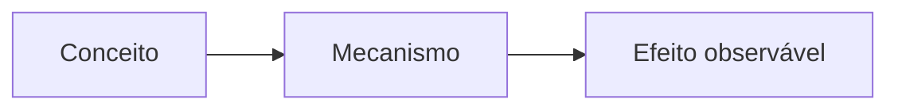

# TÍTULO

## 1. O que é?

## 2. Por que existe?

## 3. Como funciona?



## 4. Onde fica no sistema?

## 5. Quando usar? / Quando NÃO usar?

## 6. Sintaxe

```bash
comando --flag <argumento>
```

## 7. Exemplos

```bash
exemplo --seguro
```

Saída esperada:

```text
saída aqui
```

### Evidência de teste

(Obrigatória se `verification: partially-tested/tested`; ver `00-governanca/VERIFICACAO.md`.
Tabela comando → esperado → observado → estado, mais ambiente, data e limitações.)

## 8. Erros comuns

| Erro | Causa | Correção |
|------|-------|----------|
| ... | ... | ... |

## 9. Diagnóstico

## 10. Segurança

> ⚠️ Alerta (se risk >= medio): o que pode quebrar, como desfazer, alternativa segura.

## 11. Performance

## 12. Diferenças entre distribuições

| Família | Comando/Ferramenta | Observação |
|---------|--------------------|------------|
| Debian/Ubuntu | ... | ... |
| Arch | ... | ... |
| Fedora/RHEL | ... | ... |
| openSUSE | ... | ... |
| Alpine | ... | ... |
| Void | ... | ... |
| NixOS | ... | ... |

## 13. Exercício

## 14. Desafio

## 15. Referências oficiais

- ...
